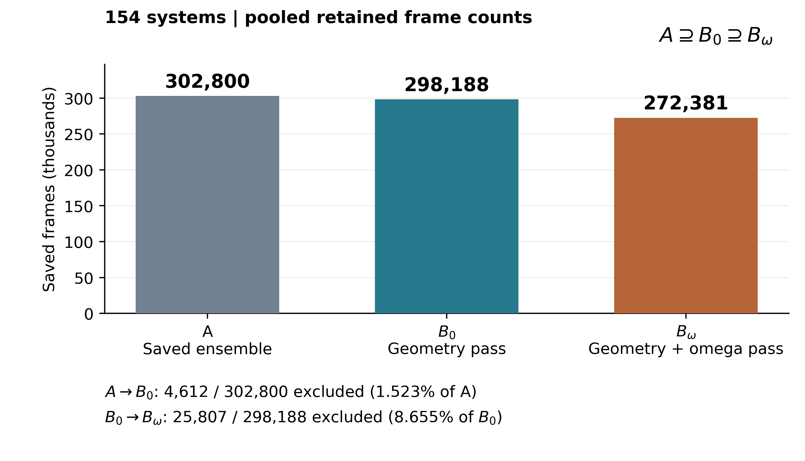
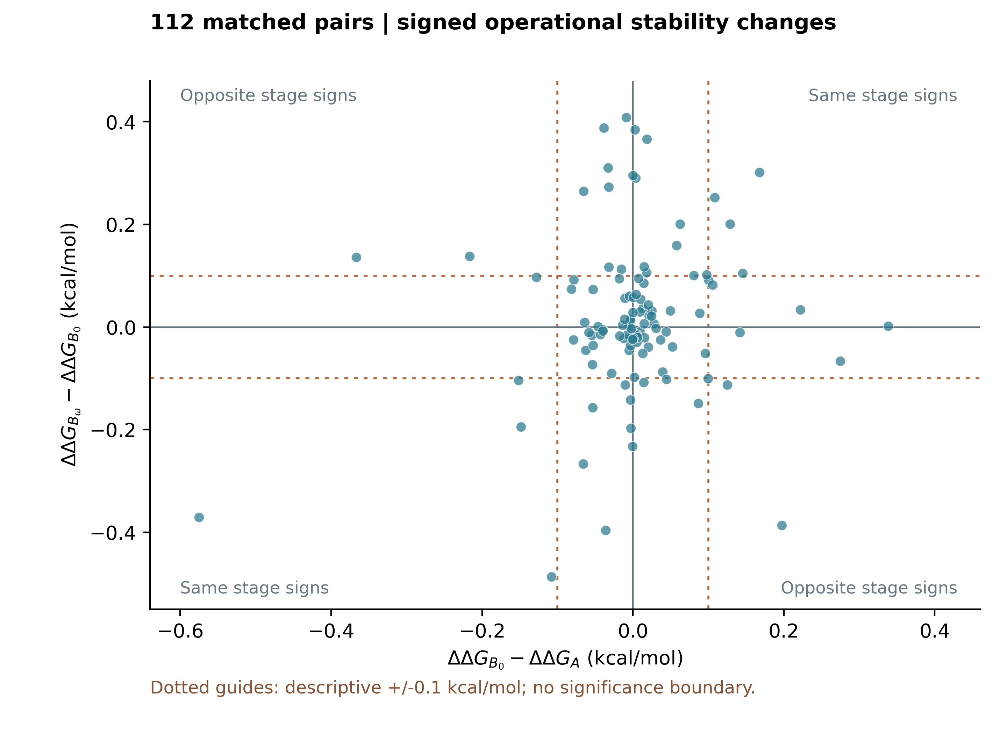

# Sensitivity of BioEmu Stability Benchmark Estimates to Sequential Geometry and Peptide-ω Screening

Sho Miyazaki

Independent researcher, Tokyo, Japan

26 October 2026 | Version 1.1.0

## Abstract

A structural screen changes the ensemble used to estimate a protein's foldedness. We asked how FNC-derived foldedness and operational stability estimates respond to sequential geometry and peptide-ω screening of one fixed BioEmu benchmark ensemble. The 154 systems comprise 42 matched baselines and 112 mutants, forming 112 pairs. Official geometry screening retained 298,188 of 302,800 saved frames; an additional screen rejecting observed peptide deviations greater than 30° from both cis and trans planarity retained 272,381. Mean soft foldedness increased in 135 systems and decreased in 14 after geometry screening, with five unchanged; the additional ω screen increased it in 131 and decreased it in 23. The nonlinear foldedness-to-ΔG transformation and mutant-minus-baseline subtraction produced heterogeneous system and pair responses. Paired signed changes ranged from -0.575240 to +0.338207 kcal/mol for geometry screening and from -0.486820 to +0.408504 kcal/mol for the additional ω screen. Secondary comparison with fixed experimental references gave MAEs of 0.702595, 0.696142 and 0.707681 kcal/mol. An independent read-only implementation reproduced all 462 system-stage foldedness and ΔG values and all 336 pair-stage ΔΔG and absolute-error values within prespecified tolerances. This is a traceable case record of sensitivity in a saved ensemble, without evidence of recovered equilibrium populations or generally improved predictions.

## 1. Introduction and research question

BioEmu generates protein conformations and provides a benchmark pathway from fraction of native contacts (FNC) to soft foldedness and folding stability estimates [1,3]. Geometry checks and peptide planarity checks measure different structural features. Applying either check after sampling conditions the set of conformations entering an estimator; the resulting change depends on the retained conformations as well as their number.

The primary question is: **How sensitive are FNC-derived foldedness and operational stability estimates to sequential geometry and peptide-ω screening of a fixed BioEmu benchmark ensemble, at both the system and matched-pair levels?** The contribution is limited to an auditable 154-system, 112-pair case record using existing screening rules and an existing estimator. It introduces neither a structural validation method nor a thermodynamic estimator. The peptide convention follows established structure validation practice [2]; it is not an optimized population-selection rule.

## 2. Methods

### 2.1 Fixed inputs and sequential sets

The official folding-free-energy benchmark metadata define 154 systems, 42 matched baselines, and 112 mutants [3]. The `name_wt` field defines each comparison. Some baselines already carry sequence changes or are designed proteins; “matched baseline” is used instead of assuming all are unmodified natural wild types. The saved A ensemble is restricted to these benchmark IDs within the larger official coordinate archive. A is an already saved ensemble, not the unobserved population of all generating-model outputs.

B0 is the subset of A passing the archived official geometry function. Its tests require consecutive Cα-Cα distances <4.5 Å, consecutive C-N distances <2.0 Å, and closest-heavy contacts >1.0 Å for the residue pairs selected by the official clash routine (sequence separation >2 and a 6 Å Cα candidate prefilter). These checks act on the atoms provided in the saved topology; passage does not certify complete all-atom physical validity.

For each adjacent peptide, ω is measured using Cα(i)-C(i)-N(i+1)-Cα(i+1). Let d(ω) be the smaller circular angular distance to 0° or 180°. A known bond is twisted when d(ω)>30°. Bω retains B0 frames with no observed twisted bond, so A ⊇ B0 ⊇ Bω. Cis peptides, including cis non-Pro peptides, are not automatically rejected. Pro annotations refer to residue i+1 and do not change this cutoff. Missing or degenerate angles are Unknown; the fixed rule retains a frame with Unknown if no known twist is observed. No Unknown frames occur here. Detailed comparisons and boundary conventions are in SI S2 and S5.

### 2.2 FNC, foldedness and operational stability

FNC q(x) is computed from aligned sample and reference Cα contacts. The archived official settings use sequence separation >3, reference contact distances ≤10 Å, β=5 Å⁻¹, λ=1.2 and δ=0.0 Å, explicitly passed to the function. For the reference contact set C,

$$q(x)=\frac{1}{|C|}\sum_{(i,j)\in C}\frac{1}{1+\exp\{5[d_{ij}(x)-1.2d_{ij}^{ref}]\}}.$$

Soft foldedness is calculated for each frame before averaging over a retained set S:

$$f(x)=\frac{1}{1+\exp[-20(q(x)-0.5)]},\qquad p_S=\frac{1}{|S|}\sum_{x\in S}f(x).$$

Thus p is an ensemble mean of soft contributions, not a hard folded-frame fraction or sigmoid of the mean FNC. At T=295 K and R=0.001987203599772605 kcal mol⁻¹ K⁻¹, the operational stability estimate is

$$G_S=-RT\ln\!\left[\operatorname{clip}\!\left(\frac{p'_S}{1-p'_S},10^{-10},10^{10}\right)\right],\quad p'_S=\operatorname{clip}(p_S,10^{-10},1-10^{-10}).$$

We label this quantity ΔG in results, with folded-minus-unfolded sign. Negative ΔG corresponds to larger soft foldedness. No pseudocount is added. Empty sets are noncomputable; none occurs, and no stage value is clipped. For each metadata-defined pair, ΔΔG_S=ΔG_mutant,S−ΔG_baseline,S. All energy estimates and differences are in kcal/mol and remain conditional on the operational state definition and saved model ensemble.

### 2.3 Primary changes and secondary reference errors

All signed changes mean later stage minus earlier stage, for A→B0, B0→Bω and cumulatively A→Bω. For an edge a→b, the paired change decomposes as

$$D_{a\to b}=(G_{m,b}-G_{m,a})-(G_{r,b}-G_{r,a}),$$

where m is the mutant and r its matched baseline. Opposite-signed system shifts reinforce the magnitude of this subtraction; same-signed shifts can cancel. Separately, the signs of D_A→B0 and D_B0→Bω determine reinforcement or cancellation across sequential stages. These are distinct comparisons.

The secondary analysis uses the official `ddg_exp` reference unchanged: AE_pair,S=|ΔΔG_pair,S−ΔΔG_exp|, and MAE_S is the unweighted mean of exactly 112 AEs. “Improved” means a strictly negative later-minus-earlier AE; “worsened” means strictly positive; exact zero is unchanged. Shared baselines make the 112 pairs dependent. No statistical comparison, bootstrap, new threshold search, or random-removal control is performed. |D|≥0.1 kcal/mol is an arbitrary descriptive count only and does not define the primary conclusion.

### 2.4 Verification

A new implementation, separate from the primary scripts, recalculates values from saved FNC arrays and masks before opening historical numerical result CSVs for comparison. V0 checks hashes, IDs, masks and counts; V1 checks foldedness, ΔG, paired ΔΔG and changes; V2 checks experimental references, all AEs, MAEs and changes. Twenty-two artificial-input tests preceded full-study comparison. Direct absolute tolerances were fixed in advance at 1e-10 for p, 1e-9 for system ΔG and 2e-9 for ΔΔG, AE and MAE, with explicitly larger limits for differences (SI S8). Separate interval evaluations propagate the p acceptance interval through the clipped nonlinear transform. These arithmetic checks are distinct from V3, which needs original coordinates. The 26 October L1/L2 coordinate evidence is evaluated as subsequent verification, not as original research output or a newly executed coordinate replay.

## 3. Results

### 3.1 Frame retention and structural screening

Geometry screening removed 4,612/302,800 saved frames (1.523% of A). The ω screen then removed 25,807/298,188 frames (8.655% of B0), leaving 272,381 (Figure 1). Within B0, 27,329 of 14,922,082 evaluable **bond-frame observations** were twisted; those observations occurred in 25,807 frames. Bond-frame and frame denominators are different. Every system retains frames; the minimum Bω count is 128.

**Figure 1. Sequential retention within the fixed 154-system ensemble.** Bars show pooled frame counts, not averages over systems. A is the saved benchmark ensemble; B0 passes the archived official geometry checks; Bω additionally has no observed peptide deviation >30° from both planar references. Exclusions are 4,612/302,800 for the first edge and 25,807/298,188 for the second; their denominators differ. The sets are nested, A ⊇ B0 ⊇ Bω. Retention does not establish equilibrium recovery or complete physical validity.

### 3.2 Foldedness sensitivity

Geometry screening increased p in 135/154 systems, decreased it in 14, and left five unchanged. The median B0−A change was +0.002133, with range -0.000798 to +0.069137. The additional ω screen increased p in 131 systems and decreased it in 23; the median Bω−B0 change was +0.001850, with range -0.011552 to +0.045725. Cumulative changes had median +0.004721 and range -0.000855 to +0.108705 (147 increased, seven decreased). These heterogeneous responses establish sensitivity without selecting an effect-size threshold.

### 3.3 System-level operational ΔG sensitivity

The first and second screening edges had median signed ΔG changes of -0.057312 and -0.059560 kcal/mol, respectively (Table 1). Increasing p decreases ΔG; the logit can produce a relatively large ΔG shift when p is near an endpoint. A removal fraction therefore does not determine the energy response. Full stage values and differences for all 154 systems accompany the SI.

**Table 1. Signed system and pair sensitivity (kcal/mol).** All entries summarize fixed units; they are not confidence intervals. Medians of successive changes need not sum to the median cumulative change.

| Edge | System ΔG median | System ΔG range | Paired ΔΔG median | Paired ΔΔG range |
| --- | ---: | --- | ---: | --- |
| A→B0 | -0.057312 | -0.769489 to +0.024709 | +0.000966 | -0.575240 to +0.338207 |
| B0→Bω | -0.059560 | -0.570955 to +0.130724 | +0.000845 | -0.486820 to +0.408504 |
| A→Bω | -0.128354 | -1.009330 to +0.059266 | +0.005979 | -0.945805 to +0.469252 |

### 3.4 Paired operational ΔΔG sensitivity

The distributions of signed pair changes span both signs at both edges (Table 1; Figure 2). For example, B0→Bω changes were -0.239841 kcal/mol for `1TG0__E1N` and +0.130724 for its matched baseline `1TG0`. Subtracting the latter yields D=-0.370565 kcal/mol. Both system changes contribute to that paired magnitude. Conversely, similar same-signed mutant and baseline shifts can cancel in ΔΔG.

Using the descriptive |D|≥0.1 kcal/mol count gives 19/112 pairs for A→B0 and 40/112 for B0→Bω, with intersection 12 and union 47. The cumulative count is 44/112 because signed stage changes add, whereas their separate threshold flags do not. These counts supplement the continuous results; neither the research question nor its conclusion depends on 0.1 kcal/mol.

**Figure 2. Signed changes in paired operational ΔΔG at the two screening edges.** Each point is one of 112 metadata-defined mutant-minus-matched-baseline pairs. The horizontal axis is ΔΔG_B0−ΔΔG_A; the vertical axis is ΔΔG_Bω−ΔΔG_B0, in kcal/mol. Same-sign quadrants indicate reinforcement of the two sequential stage changes in their sum; opposite-sign quadrants indicate counteraction across stages. This quadrant classification is not the mutant-versus-baseline decomposition within either edge. Dotted ±0.1 guides are arbitrary descriptive thresholds, not significance or physical validity boundaries. Shared baselines mean the points are not independent biological replicates.

### 3.5 Secondary experimental-reference comparison

MAE was 0.702595 kcal/mol for A, 0.696142 for B0 and 0.707681 for Bω. The changes were -0.006453 for A→B0, +0.011539 for B0→Bω and +0.005086 cumulatively. Per-pair AEs improved/worsened/unchanged in 59/52/1 comparisons for A→B0, 54/58/0 for B0→Bω, and 54/58/0 for A→Bω. All 336 AEs are supplied. These descriptive changes do not establish a preferred geometry filter or ω gate, or generally improved prediction accuracy.

## 4. Discussion

Conditioning a finite saved ensemble changes a soft-foldedness mean according to the composition removed. For a parent set of n frames, r removed frames and removed-set mean p_removed, p_retained−p_parent=r(p_parent−p_removed)/(n−r). This identity, the nonlinear ΔG transformation and the paired subtraction account arithmetically for the observed signed changes. They do not identify a causal physical mechanism linking local peptide twist to true thermodynamic stability.

The useful outcome is the explicit connection from archive identifiers and screening masks to system and matched-pair endpoints. The official benchmark defines the observable and references; this study preserves those definitions while documenting sensitivity to sequential selection. It does not reinterpret the secondary MAE comparison as a basis for adopting a screen.

## 5. Limitations

The saved A archive may already reflect generation-time processing; no unsaved model population is recovered. Geometry passage does not certify full physical validity, and the operational p is not an experimentally measured folded population. No equilibrium reweighting, experimental correction, population uncertainty or general prediction improvement is demonstrated. Shared baselines and other sequence relationships limit independence. Finite-sample precision, especially near p endpoints, is not quantified by the deterministic replay tolerances.

The original execution environment and complete contemporaneous approval history are not reconstructed. Original-coordinate QA in the earlier public record covered 10 selected systems/2,700 frames. Subsequent 26 October L2 records cover all 154 systems, but reuse official FNC/clash functions and MDTraj loading, and have incomplete dependency fingerprints. This Work checks those records and all saved arrays, without downloading or replaying the 1.96 GB coordinate archive. L2 is not a fully independent end-to-end implementation.

Existing ±0.02° boundary diagnostics concern 292 B0 frames (302 across A). Both specified alternative treatments yield 39 rather than 40 descriptive threshold crossings. Their paired results fail to bracket the primary value in 29/112 pairs; they are selection scenarios, not error bounds. The primary calculation is unchanged.

## 6. Conclusions

Sequential geometry and peptide-ω screening of this fixed ensemble changes FNC-derived foldedness and operational ΔG and ΔΔG estimates heterogeneously. Mutant-minus-matched-baseline subtraction can amplify or cancel system changes. The continuous system and pair results support that conclusion independently of an arbitrary reporting threshold. The contribution is a limited, reproducible case record, without a recommendation to adopt either gate.

## 7. Data and code availability

The original published version is https://doi.org/10.5281/zenodo.23615869. The maintained repository is https://github.com/shomiyazaki-ai/bioemu-filter-sensitivity-ntbe-x2-omega. Version 1.1.0 has the reserved Zenodo version DOI https://doi.org/10.5281/zenodo.23660292 and its GitHub release tag v1.1.0 points to commit 847381760709a9b4ff2e3d79d3fa7f37d91223b5. Zenodo publication status must be verified separately. The version 1.1.0 archive preserves original outputs and code, includes the saved 154-member NPZ and official metadata, and adds editable manuscripts, figure sources, independent verification code, full comparison outputs and manifests. README.md gives the tested V0-V2 route and the separate, coordinate-dependent V3 route. SI S8 distinguishes executed work from inherited records. Upstream code/data remain available from [3].

## 8. Declarations

Funding: no external funding for these independent analyses. Competing interests: none declared. Affiliation: Independent researcher, Tokyo, Japan. BioEmu and benchmark contributors are credited through [1,3]; upstream experimental data through [4]. ChatGPT assisted with planning, code and data checks, manuscript and figure preparation, and QC; the author directed the research and is responsible for scientific interpretation and release. P3 is a structured self-review within the same Work, not a separate human or model audit. Original text/figures retain CC BY 4.0 and eligible author-owned code MIT; third-party materials retain the separate notices in licenses/. These declarations carry forward the author-reviewed statements; legal applicability of third-party notices remains source-specific.

## References

[1] Lewis, S., Hempel, T., Jiménez-Luna, J., et al. Scalable emulation of protein equilibrium ensembles with generative deep learning. Science 389 (2025), eadv9817. https://doi.org/10.1126/science.adv9817

[2] Williams, C. J., Headd, J. J., Moriarty, N. W., et al. MolProbity: More and better reference data for improved all-atom structure validation. Protein Science 27 (2018), 293-315. https://doi.org/10.1002/pro.3330

[3] Microsoft Research. Supplementary data for scalable emulation of protein equilibrium ensembles with generative deep learning. Zenodo record 15672282 (2025), including bioemu-benchmarks_code_release.zip and samples_delta_G.zip. https://doi.org/10.5281/zenodo.15672282. Software: https://github.com/microsoft/bioemu-benchmarks and https://github.com/microsoft/bioemu. The archived bytes, rather than current main branches, define this study.

[4] Tsuboyama, K., et al. Mega-scale experimental analysis of protein folding stability in biology and design. Nature 620 (2023), 434-444. https://doi.org/10.1038/s41586-023-06328-6. Upstream experimental source identified by the official benchmark dataset card; reference values here are taken directly from the benchmark metadata, without reanalysis of the experiments.